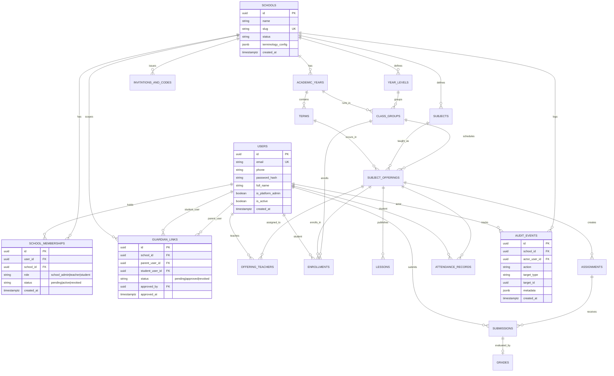
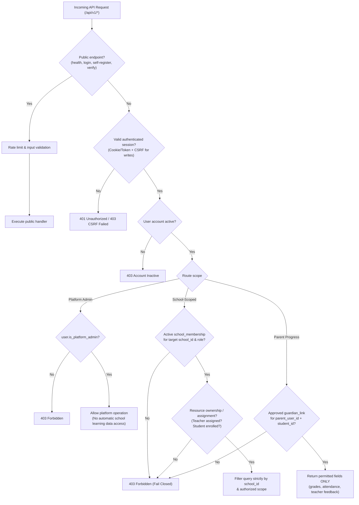

# IMPLEMENTATION.md — Technical Architecture & Build Plan

This document translates [PRODUCT_REQUIREMENTS.md](PRODUCT_REQUIREMENTS.md) into a concrete backend architecture and 10-slice implementation plan.

## 1. Confirmed Technical Decisions

| Area | Decision | Notes |
| --- | --- | --- |
| Backend framework | FastAPI (Python 3.13+) | Lives in `backend/`, versioned under `/api/v1` |
| Frontend (later) | Next.js | Will live in `frontend/` as a separate client |
| Database | PostgreSQL (local for dev) | Synchronous SQLAlchemy 2.0 + `psycopg` v3 |
| Migrations | Alembic | Wired to `app.core.config` and `app.db.base.Base` |
| Environment | Standard Python `venv` + `pip` | Managed via `backend/pyproject.toml` |
| Email provider | Resend | Transactional email (invites, verification, notifications) via an `EmailService` adapter |
| Version control | Git (`master` branch) | Remote: `https://github.com/Royal-design/lms` |

## 2. Backend Architecture

### Current Structure (Slice 1)

```text
backend/
├── pyproject.toml
├── .env.example
├── alembic.ini
├── alembic/
│   ├── env.py
│   ├── script.py.mako
│   └── versions/
├── app/
│   ├── main.py              # App factory, CORS, security headers, router mount
│   ├── core/
│   │   └── config.py        # pydantic-settings configuration
│   ├── db/
│   │   ├── base.py          # DeclarativeBase + deterministic constraint naming
│   │   └── session.py       # Engine, sessionmaker, get_db() dependency
│   └── api/
│       └── v1/
│           ├── router.py    # Combines v1 routers
│           └── health.py    # GET /api/v1/health
└── tests/
    └── test_health.py
```

### Target Structure (Slices 2–9)

As domain slices are added, keep layers cleanly separated inside `backend/app/`:

- `app/models/` — SQLAlchemy ORM models (one module per domain area, imported in `app/models/__init__.py` for Alembic autogenerate).
- `app/repositories/` — Lightweight, `school_id`-scoped SQLAlchemy query functions (keeps tenant filtering explicit and reusable).
- `app/schemas/` — Pydantic request/response schemas (strict input validation, explicit response models so internal fields never leak).
- `app/services/` — Business rules, state transitions, transaction boundaries, and audit event recording.
- `app/core/security.py` — Password hashing, token/session handling, and cryptographic helpers.
- `app/api/deps.py` — Reusable FastAPI dependencies for authentication, role checks, and school/resource authorization.
- `app/api/v1/` — Thin route handlers delegating to services.

## 3. Multi-Tenancy & Identity Model

To satisfy both strict school isolation and multi-school parent access:

1. **Identity is global (`users`):** One login account per person (email/phone, password hash, account status).
2. **School access is explicit (`school_memberships`):** Links a `user_id` to a `school_id` with a `role` (`school_admin`, `teacher`, `student`) and `status` (`pending`, `active`, `revoked`).
   - Database constraint enforces at most **one active school membership** for a `teacher` (`AUTH-03`).
   - Platform administrators are flagged separately (`is_platform_admin`) and do not automatically receive school-level read access to student learning data.
3. **Parent/guardian links (`guardian_links`):** Links a parent `user_id` to a student record (`student_id`, `school_id`) with `status` (`pending`, `approved`, `revoked`) and approval metadata (`AUTH-04`).
4. **Request authorization flow:**
   - Authenticate user → resolve active role/membership for the target `school_id` (or approved `guardian_link` for parent endpoints) → verify resource ownership/assignment before reading or mutating data.

### 3.1 Database Plan (ERD)

Every school-owned table carries `school_id` to enforce strict tenant isolation. Login accounts (`users`) are separated from school roles (`school_memberships`) and multi-school parent relationships (`guardian_links`).



### 3.2 Request Authorization & Multi-Tenant Flowchart



### 3.3 Email Provider Plan (Resend)

**Provider:** [Resend](https://resend.com) for all transactional emails (staff/student invitations, student registration decisions, parent link verification & approval notices, and future assignment/grade alerts).

- **Adapter architecture (`app/services/email.py`):**
  - Define an `EmailProvider` protocol/interface with `send_email(to, subject, html, text)`.
  - `ResendEmailProvider` — calls Resend's HTTPS API using `RESEND_API_KEY` and `EMAIL_FROM` in staging/production.
  - `ConsoleEmailProvider` (or `InMemoryEmailProvider` in `pytest`) — used in local dev/tests when `EMAIL_PROVIDER=console` so automated tests never send real emails or require live API keys.
- **Configuration (env vars, never hardcoded):**
  - `EMAIL_PROVIDER`: `console` (default for local dev/test) or `resend` (staging/production).
  - `RESEND_API_KEY`: Required when `EMAIL_PROVIDER=resend` (fail fast on startup if missing).
  - `EMAIL_FROM`: Verified sender address (e.g., `no-reply@yourdomain.com`, with SPF/DKIM/DMARC verified in Resend before production).
  - `FRONTEND_BASE_URL`: Used to construct invitation/verification links safely (allow-listed, never derived from untrusted request `Host` headers).
- **Security & reliability rules:**
  - Never log raw invitation tokens, verification codes, or `RESEND_API_KEY`.
  - Commit the database record first, then trigger email delivery; if Resend returns a transient error/timeout, return a clear status or queue a retry without corrupting DB state, and expose a rate-limited "resend invite" action (with cooldown) for school admins.

### 3.4 Edge & Error Case Matrix

All endpoints must handle these edge cases explicitly and consistently:

| Category | Edge / Error Case | Expected API Behavior |
| --- | --- | --- |
| **Auth & Sessions** | Wrong email or password | `401 Unauthorized` with generic message (`Invalid credentials`) — never reveal whether the email exists. |
| **Auth & Sessions** | Deactivated or suspended user logs in or uses existing session | `403 Forbidden`; invalidate active sessions on deactivation. |
| **Auth & Sessions** | Expired/revoked session or missing CSRF token on write | `401 Unauthorized` (expired session) / `403 Forbidden` (invalid CSRF). |
| **Auth & Sessions** | Brute-force login or invite resend spam | `429 Too Many Requests` with `Retry-After` header. |
| **Multi-Tenancy** | User from School A requests a resource belonging to School B | `403 Forbidden` or `404 Not Found` (never leak existence or details of School B's records). |
| **Multi-Tenancy** | Platform Admin tries to read student grades/submissions/attendance | `403 Forbidden` unless a separate explicit school role/operational permission exists. |
| **Role Invariants** | Admin tries to assign a Teacher to a second active school (`AUTH-03`) | `409 Conflict` (`TEACHER_SINGLE_SCHOOL_VIOLATION`), enforced by both service logic and PostgreSQL partial unique index. |
| **Role Invariants** | School Admin tries to revoke/demote the last active `school_admin` of a school | `409 Conflict` (`LAST_SCHOOL_ADMIN`) — prevents locking out a school. |
| **Role Invariants** | Pending student tries to access classes, lessons, or assignments (`AUTH-02`) | `403 Forbidden` (`MEMBERSHIP_PENDING`). |
| **Role Invariants** | Parent tries to view unapproved/revoked child or accesses lessons/assignments (`PROG-02`) | `403 Forbidden` — parent access is restricted to approved child progress fields only. |
| **State Transitions** | Approving/rejecting an already-processed registration or revoking an already-revoked link | `409 Conflict` (`INVALID_STATE_TRANSITION`). |
| **Duplicates & Integrity** | Duplicate school slug, duplicate email, or duplicate active membership | `409 Conflict` with machine-readable error code. |
| **Historical Data** | Deleting a class, subject, or withdrawing a student who has grades/attendance | Reject destructive delete (`409 Conflict`) or transition status/effective end date so historical records remain intact (`SCH-04`). |
| **Invites & Tokens** | Expired, tampered, or already-used invitation/verification token | `400 Bad Request` or `410 Gone` (`TOKEN_INVALID_OR_EXPIRED`); token hash is marked used atomically to prevent race-condition replay. |
| **Email Delivery (Resend)** | Resend API timeout, rate limit, or 5xx error during invite | Log sanitized failure (no token/PII), do not roll back valid user/invite creation silently without informing caller, return clear warning/retryable state. |
| **Validation & Files** | Malformed UUID, invalid enum, missing required field | `422 Unprocessable Entity` with field-level validation errors. |
| **Validation & Files** | Disallowed file extension/magic bytes or oversized upload (Slice 6+) | `415 Unsupported Media Type` / `413 Payload Too Large`. |
| **Infrastructure** | PostgreSQL connection failure or unexpected server error | `503 Service Unavailable` (DB down) or `500 Internal Server Error` with generic message; never expose SQL queries or tracebacks. |

## 4. Vertical Slice Roadmap

### Slice 1 — FastAPI Foundation *(Done)*
- **Scope:** Project scaffold, config, PostgreSQL SQLAlchemy setup, Alembic, security headers, CORS, `GET /api/v1/health`, and automated tests.

### Slice 2 — Schools, Accounts, Auth & School-Scoped Authorization
- **Requirements:** `SCH-01`, `AUTH-01`, `AUTH-03`, `AUTH-05`, `AUTH-06`
- **Tables:** `schools`, `users`, `school_memberships`, `audit_events` (plus session/refresh token store if using stateful sessions).
- **Key deliverables:** Platform admin school management, user creation/login/logout, school role assignment, teacher single-school constraint, school-scoped authorization dependencies, rate limiting, and audit logging.

### Slice 3 — Academic Structure, Enrollments & Bulk Import
- **Requirements:** `SCH-02`, `SCH-03`, `SCH-04`, `SCH-05`
- **Tables:** `academic_years`, `terms`, `year_levels`, `class_groups`, `subjects`, `subject_offerings`, `offering_teachers`, `enrollments`.
- **Key deliverables:** CRUD for school academic hierarchy, enrollment/transfer/withdrawal preserving history (effective dates + status), CSV/XLSX dry-run validation + commit import for students and staff.

### Slice 4 — Student Self-Registration & Approval
- **Requirements:** `AUTH-02`, `AUTH-06`
- **Tables:** `registration_codes` / `invitations`, `student_registration_requests`.
- **Key deliverables:** Student registration with school-issued code/invitation (pending state, zero school data access), school admin review/approve/reject workflow with enrollment matching and audit log.

### Slice 5 — Parent Invitations, Verification & Multi-School Links
- **Requirements:** `AUTH-04`, `AUTH-06`, `PROG-02` (link foundation)
- **Tables:** `guardian_links`, `verification_tokens` (hashed, expiring, single-use).
- **Key deliverables:** School-initiated parent invite, contact verification, admin approval/revocation, multi-school child listing for a single parent account, full audit trail.

### Slice 6 — Lessons & Secure File Storage
- **Requirements:** `LEARN-01`
- **Tables:** `lessons`, `lesson_attachments` / `stored_files`.
- **Key deliverables:** Teacher lesson publishing for assigned subject offerings, student read access for enrolled offerings, secure file upload/download (allow-list, size limit, UUID storage outside web root, authorized download streaming).

### Slice 7 — Assignments, Submissions & Resubmission Rules
- **Requirements:** `ASSIGN-01`, `ASSIGN-02`, `ASSIGN-03`
- **Tables:** `assignments`, `assignment_attachments`, `submissions`, `submission_files`.
- **Key deliverables:** Teacher assignment creation, student text + file submissions, timestamping, late/resubmission policy enforcement, and submission version history.

### Slice 8 — Grades, Feedback & Student/Parent Progress Views
- **Requirements:** `ASSIGN-04`, `PROG-01`, `PROG-02`
- **Tables:** `grades` (with publish status/history as decided), `audit_events` integration.
- **Key deliverables:** Teacher grading and feedback on submissions, student self-view, and parent view strictly scoped to approved linked children's grades, attendance, and feedback.

### Slice 9 — Attendance & History
- **Requirements:** `ATT-01`, `ATT-02`, `PROG-01`, `PROG-02`
- **Tables:** `attendance_records`, `attendance_history` (or audit trail with responsible user + timestamp).
- **Key deliverables:** Teacher attendance entry per assigned class/subject offering and date, edit attribution, student and approved parent attendance history views.

### Slice 10 — Deployment, Backups, Monitoring & Privacy Review
- **Scope:** Production hardening (TLS/mTLS for PostgreSQL, secrets management, automated encrypted backups, structured PII-safe logging, retention/deletion rules, and NDPA 2023 / local privacy review).

## 5. Open Decisions Mapped to Blocking Slices

These items from Section 10 of `PRODUCT_REQUIREMENTS.md` should be finalized before starting the slice that depends on them:

| # | Decision | Needed Before |
| --- | --- | --- |
| 1 | Initial operating country/countries & privacy compliance scope | Slice 10 (confirm early for data fields) |
| 2 | Student onboarding: invitation, short-lived registration code, or both | Slice 4 |
| 3 | Configurable class/year terminology & grading scales per school | Slice 3 & Slice 8 |
| 4 | Late submission & resubmission rules (school-level vs per-assignment) | Slice 7 |
| 5 | Allowed submission file types and max upload size | Slice 6 / Slice 7 |
| 6 | Required attendance statuses (e.g., present, absent, late, excused) | Slice 9 |
| 7 | Whether grades stay hidden until explicitly published by a teacher | Slice 8 |
| 8 | Notification channels (email, SMS, in-app) for invites/updates | **Email decided: Resend** (SMS/in-app optional later, confirm before Slice 4/5) |
| 9 | Hosting, backup cadence, expected user volume, and availability targets | Slice 10 |
